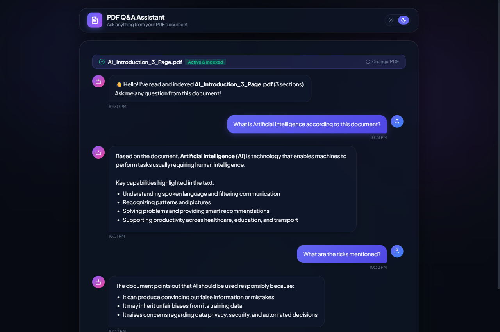
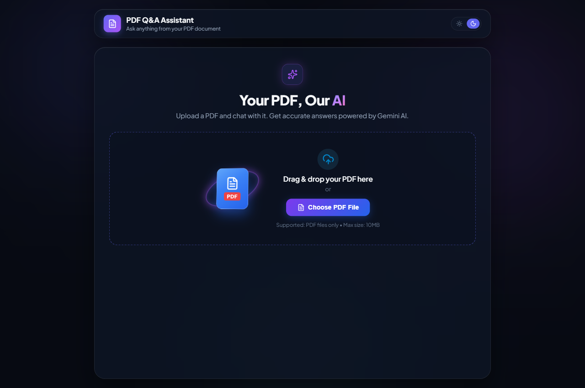
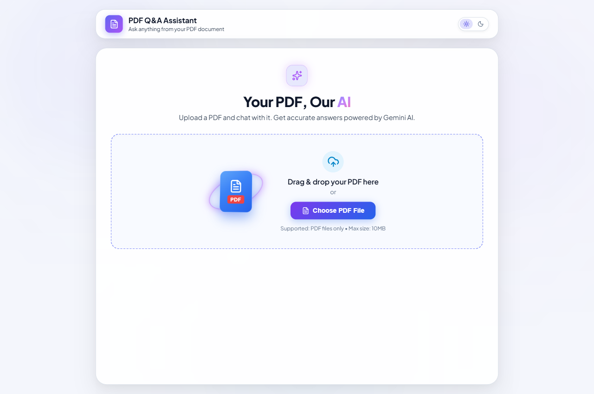
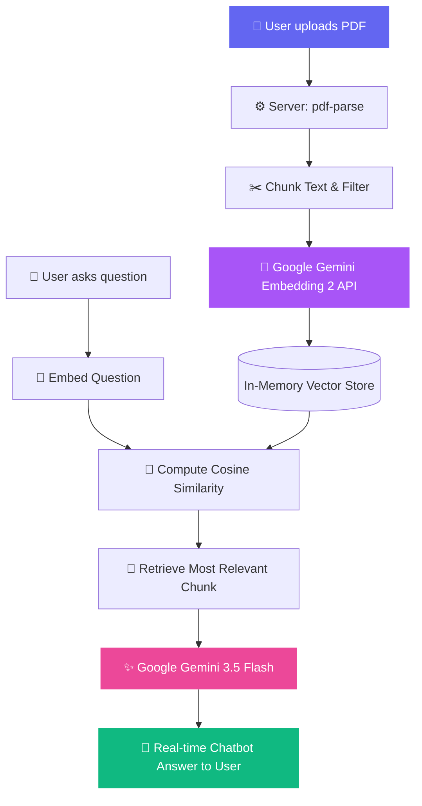

<div align="center">

# 📑 Chat with PDF — Intelligent AI Q&A Assistant

### *Transform Any PDF Into An Interactive AI Conversation Partner In Seconds*

[](https://opensource.org/licenses/MIT)
[](https://aistudio.google.com/)
[](https://react.dev/)
[](https://vite.dev/)
[](https://nodejs.org/)
[](https://github.com)

<br/>

[](docs/screenshots/chat-dark.png)

*Real-time AI Chatbot conversation stream powered by Gemini 3.5 Flash & In-Memory Vector Search*

<br/>

[🌟 Star on GitHub](https://github.com/chinmayrane-491/chat-with-pdf) • [📹 Watch Demo Video](docs/videos/chat_with_pdf_demo.webm) • [🐛 Report Bug](https://github.com/chinmayrane-491/chat-with-pdf/issues)

</div>

---

## 🎥 Video Demonstration

Check out the full 35-second walkthrough demonstrating theme toggling, document upload, and real-time AI conversation:

> 🎬 **Video File**: [`docs/videos/chat_with_pdf_demo.webm`](docs/videos/chat_with_pdf_demo.webm) (720p HD, 25 FPS)

---

## 🌟 Overview

**Chat with PDF** is a full-stack, AI-powered document intelligence chatbot. Rather than reading through dense documents or manuals, simply upload your PDF and chat with it in natural language. 

Using **Google Gemini Embedding 2** and **Normalized Cosine Similarity (RAG)**, the application breaks your document into chunks, creates semantic vector embeddings, and feeds only the most relevant sections into **Gemini 3.5 Flash** for lightning-fast, hallucination-free answers.

---

## 📸 Screenshots & Themes

<table align="center" width="100%">
  <tr>
    <td align="center" width="50%">
      <b>🌙 Modern Dark Mode</b><br/><br/>
      
    </td>
    <td align="center" width="50%">
      <b>☀️ Clean Light Mode</b><br/><br/>
      
    </td>
  </tr>
</table>

---

## 🚀 Key Features

- 📑 **Drag & Drop Upload**: Fluid file dropzone with instant client-side PDF validation and 3D floating graphic.
- 🤖 **Interactive Chatbot Experience**: Real-time conversation stream with animated **"AI-Bot is typing..."** bouncing dots.
- 🧠 **Vector Semantic Search (RAG)**: Chunks documents and generates embeddings via `gemini-embedding-2` for pinpoint semantic matching.
- ⚡ **Gemini 3.5 Flash Intelligence**: High accuracy and ultra-low latency text generation formatted in clean GitHub-flavored Markdown.
- 🎨 **Adaptive Glassmorphism UI**: Beautiful neon glows and backdrop blurs, with full one-click **Light & Dark mode** support.
- 📋 **One-Click Answer Copy**: Built-in clipboard copying with visual confirmation.
- 🔄 **Smart Session Caching**: Upload a document once and ask dozens of follow-up questions without re-uploading or re-indexing.
- 🔒 **Zero Data Retention**: Temporary PDF uploads are immediately purged from the server after memory indexing.

---

## 🏗️ Architecture & RAG Workflow



---

## 🛠️ Tech Stack

| Component | Technology | Description |
| :--- | :--- | :--- |
| **Frontend Framework** | **React 19 + Vite** | Fast SPA bundled with HMR |
| **Icons & Design** | **Lucide Icons** | Clean, accessible vector icons |
| **Styling** | **Custom CSS & Glassmorphism** | Responsive design with CSS variable theming |
| **Backend Framework** | **Node.js & Express** | RESTful API server with CORS enabled |
| **File Processing** | **Multer & pdf-parse** | Multipart form handling and PDF text extraction |
| **AI SDK** | **`@google/genai`** | Official Google GenAI SDK for Gemini 3.5 & Embeddings |
| **Vector Search** | **Cosine Similarity Algorithm** | Normalized vector dot-product matching |

---

## ⚡ Getting Started

Follow these simple steps to run the project locally.

### 📋 Prerequisites

- **Node.js** (v18 or higher) — [Download Node.js](https://nodejs.org/)
- **Google Gemini API Key** — [Get Free API Key from Google AI Studio](https://aistudio.google.com/app/apikey)

---

### 1️⃣ Clone the Repository

```bash
git clone https://github.com/your-username/chat-with-pdf.git
cd chat-with-pdf
```

---

### 2️⃣ Backend Configuration

1. Navigate to the `server/` directory and install dependencies:
   ```bash
   cd server
   npm install
   ```

2. Copy the example environment file:
   ```bash
   cp .env.example .env
   ```

3. Open `server/.env` and insert your Gemini API Key:
   ```env
   GEMINI_API_KEY=your_actual_gemini_api_key_here
   PORT=5001
   ```

4. Start the backend server:
   ```bash
   node index.js
   ```
   > 🚀 Backend will run at: **`http://localhost:5001`**

---

### 3️⃣ Frontend Setup

1. Open a new terminal tab, navigate to the `frontend/` directory and install dependencies:
   ```bash
   cd frontend
   npm install
   ```

2. Start the Vite development server:
   ```bash
   npm run dev
   ```
   > 🌐 Frontend will be available at: **`http://localhost:5173`**

---

## 📡 API Reference

### `POST /upload`
Uploads and indexes a PDF document into in-memory vector storage.

- **Content-Type**: `multipart/form-data`
- **Body**: 
  - `pdf`: File binary (`.pdf`)
  - `question` *(optional)*: String
- **Response**:
  ```json
  {
    "success": true,
    "filename": "AI_Introduction.pdf",
    "totalChunks": 3,
    "answer": "Document uploaded and indexed successfully!"
  }
  ```

### `POST /ask`
Submits a question to the currently indexed PDF document.

- **Content-Type**: `application/json`
- **Body**:
  ```json
  {
    "question": "What are the main risks mentioned in this document?"
  }
  ```
- **Response**:
  ```json
  {
    "success": true,
    "answer": "Based on the provided context, the risks include...",
    "bestScore": 0.784,
    "filename": "AI_Introduction.pdf"
  }
  ```

---

## 🤝 Contributing

Contributions make the open-source community an amazing place to learn, inspire, and create. Any contributions you make are **greatly appreciated**!

1. Fork the Project
2. Create your Feature Branch (`git checkout -b feature/AmazingFeature`)
3. Commit your Changes (`git commit -m 'feat: Add AmazingFeature'`)
4. Push to the Branch (`git push origin feature/AmazingFeature`)
5. Open a Pull Request

---

## ⭐ Support & Star

If this project helped you or gave you inspiration, please give it a **⭐ Star** on GitHub! It helps more developers discover the project.

---

## 📄 License

Distributed under the **MIT License**. See [`LICENSE`](LICENSE) for more information.

<div align="center">
  <sub>Built with ❤️ by <a href="https://github.com">Chinmay</a></sub>
</div>
